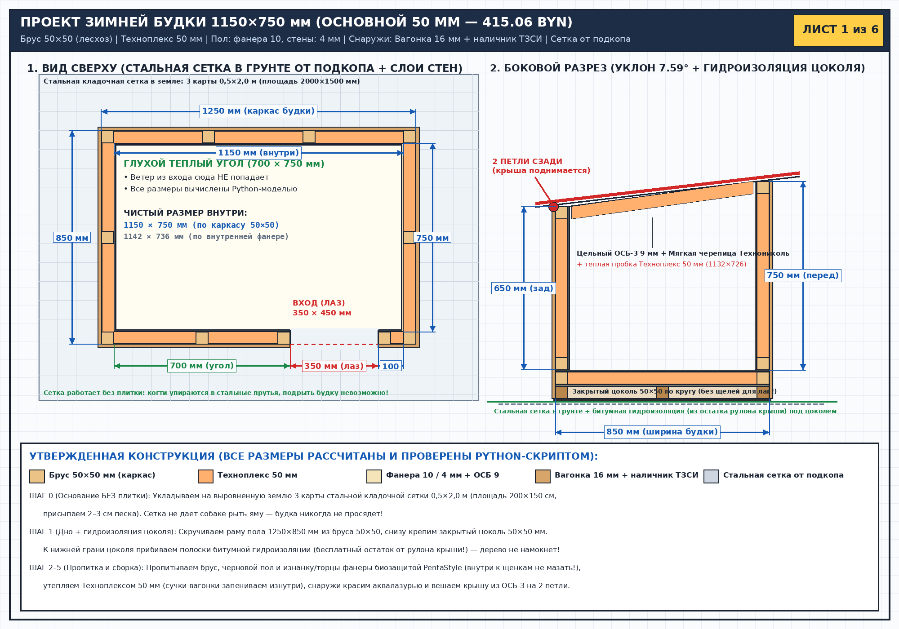
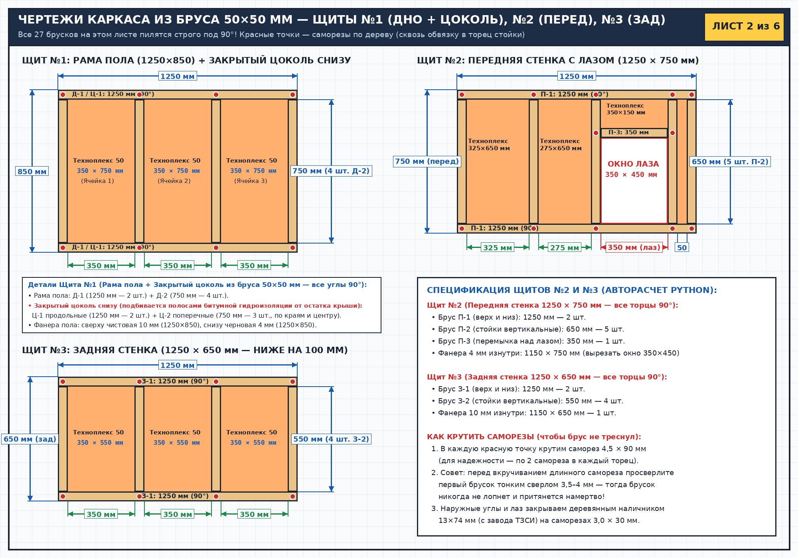
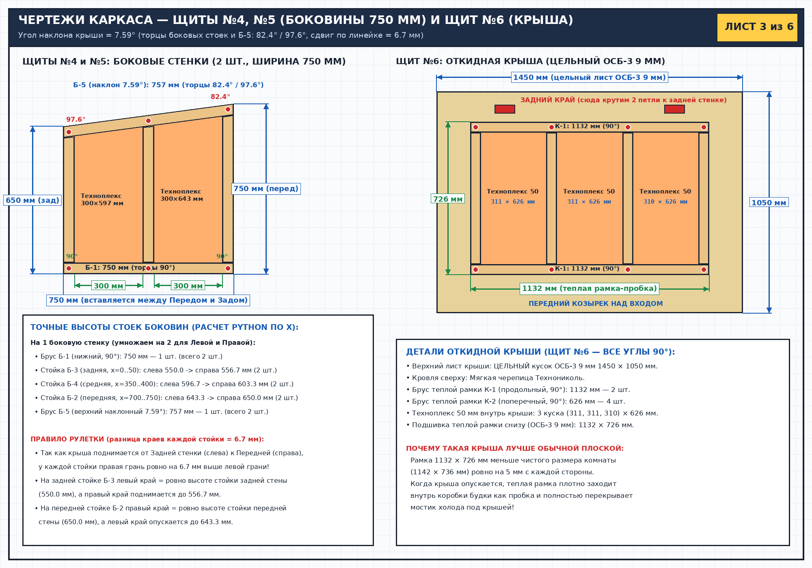
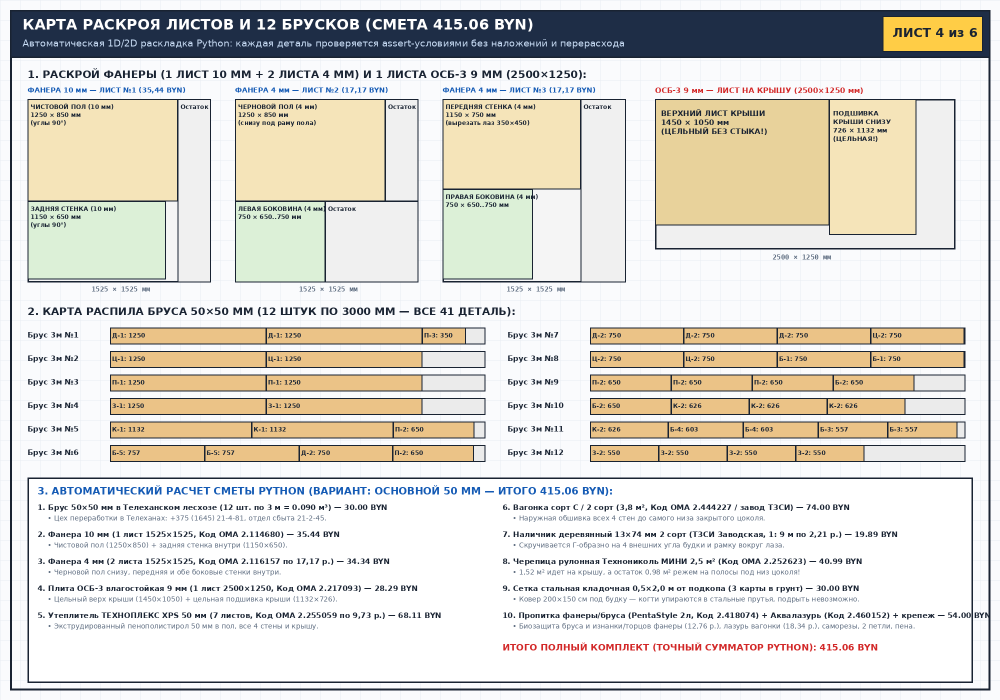
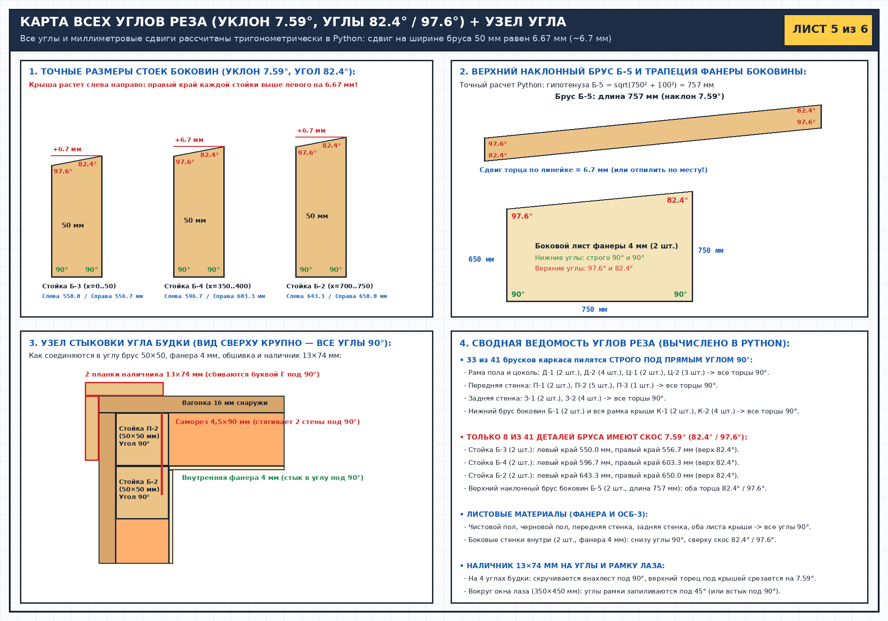
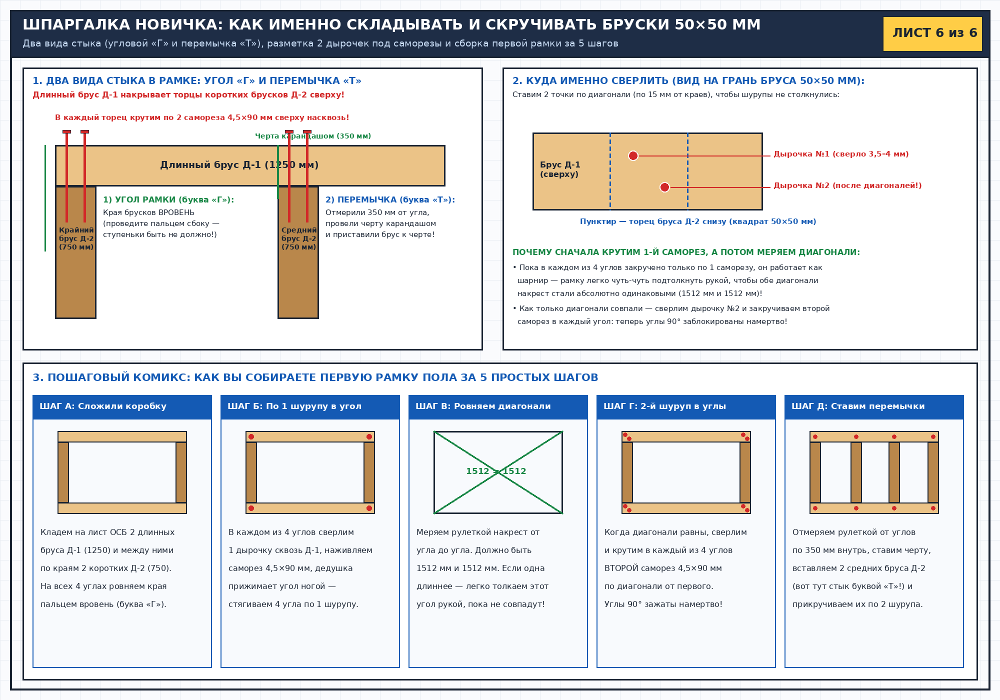

# Проект зимней утепленной будки 1150×750 мм — Основная версия 50 мм + вагонка снаружи (415.06 BYN)

> **100% расчетов на Python:** все линейные размеры, тригонометрические углы наклона крыши, высоты каждой стойки по координате X, раскладка по листам/брускам и итоговая смета вычисляются и проверяются `assert`-условиями в [`scripts/generate_blueprints.py`](./scripts/generate_blueprints.py) и сохраняются в [`plans/calculations_verified.json`](./plans/calculations_verified.json).
>
> **Навигация по документации проекта:**
> * [`docs/ASSEMBLY_GUIDE.md`](./docs/ASSEMBLY_GUIDE.md) — **Пошаговая инструкция по сборке и безопасной пропитке** (от распила до установки).
> * [`docs/PROCUREMENT_TELEKHANY.md`](./docs/PROCUREMENT_TELEKHANY.md) — **Где и как заказать материалы в г.п. Телеханы** (телефоны лесхоза, ТЗСИ и коды ОМА).
> * [`docs/DECISIONS.md`](./docs/DECISIONS.md) — **Журнал проектных решений** (почему выбраны именно такие размеры, узлы и материалы).
> * [`AGENTS.md`](./AGENTS.md) — **Файл-память для ИИ-агента** (автоматически загружается при открытии проекта в новой сессии).

---

## Вычисленные параметры конструкции (Основная версия 50 мм + вагонка снаружи)

* **Наружный габарит каркаса по брусу `50×50 мм`:** `1250 × 850 мм` (полный наружный габарит с обшивкой: `1282 × 882 мм`).
* **Внутренний размер комнаты по каркасу:** `1150 × 750 мм` (чистый размер по внутренней фанере: **`1142 × 736 мм`**).
* **Высота стен каркаса:** спереди `750 мм`, сзади `650 мм` (перепад высоты `100 мм` на ширине боковины `750 мм`).
* **Точный угол наклона крыши:** **`7.59°`** (острый угол **`82.4°`**, тупой угол **`97.6°`**, сдвиг по линейке на ширине бруса `50 мм` равен **`6.67 мм`** ≈ `6.7 мм`).
* **Точные высоты стоек боковых стенок (слева направо по росту ската):**
  * Задняя стойка **Б-3** (x = 0..50 мм): слева **`550.0 мм`** -> справа **`556.7 мм`**.
  * Средняя стойка **Б-4** (x = 350..400 мм): слева **`596.7 мм`** -> справа **`603.3 мм`**.
  * Передняя стойка **Б-2** (x = 700..750 мм): слева **`643.3 мм`** -> справа **`650.0 мм`**.
  * Верхний наклонный брус **Б-5**: длина **`757 мм`**, торцы запилены параллельно стойкам под **`82.4° / 97.6°`**.
* **Теплая рамка-пробка под крышей:** **`1132 × 726 мм`** (входит внутрь комнаты `1142 × 736 мм` с зазором 5 мм на сторону).

---

## Чертежи (6 листов)

### Лист 1. Общий вид, план сверху и боковой разрез

### Лист 2. Чертежи каркаса — Щит №1 (Дно + Цоколь), Щит №2 (Перед), Щит №3 (Зад)

### Лист 3. Чертежи каркаса — Щиты №4, №5 (Боковины) и Щит №6 (Откидная крыша)

### Лист 4. Карта раскроя листов, 12 брусков и автоматическая смета

### Лист 5. Карта всех углов реза (в градусах и миллиметрах) + узел стыковки угла

### Лист 6. Шпаргалка новичка: как складывать и скручивать бруски (стыки «Г» и «Т»)

---

## Таблица всех 41 деталей из бруса `50 × 50 мм` (12 брусков по 3 м = 0.09 м³)

* **33 из 41 деталей** пилятся строго под прямым углом **`90°`**.
* **Только 8 из 41 деталей** (стойки боковин `Б-3`, `Б-4`, `Б-2` и наклонный брус `Б-5`) имеют скос **`7.59°`** (`82.4° / 97.6°`, сдвиг по рулетке `6.7 мм`).

| Код | Назначение | Длина (мм) | Кол-во (шт.) | Углы торцов (левый / правый) |
| :--- | :--- | :---: | :---: | :---: |
| **Д-1** | Рама пола (продольные) | **1250** | **2** | `90.0° / 90.0°` |
| **Д-2** | Рама пола (поперечные) | **750** | **4** | `90.0° / 90.0°` |
| **Ц-1** | Закрытый цоколь (продольные) | **1250** | **2** | `90.0° / 90.0°` |
| **Ц-2** | Закрытый цоколь (поперечные) | **750** | **3** | `90.0° / 90.0°` |
| **П-1** | Передняя стенка (верх и низ) | **1250** | **2** | `90.0° / 90.0°` |
| **П-2** | Передняя стенка (стойки) | **650** | **5** | `90.0° / 90.0°` |
| **П-3** | Перемычка над лазом | **350** | **1** | `90.0° / 90.0°` |
| **З-1** | Задняя стенка (верх и низ) | **1250** | **2** | `90.0° / 90.0°` |
| **З-2** | Задняя стенка (стойки) | **550** | **4** | `90.0° / 90.0°` |
| **Б-1** | Боковины (нижний брус) | **750** | **2** | `90.0° / 90.0°` |
| **Б-2** | Боковины (передняя стойка 643.3..650.0) | **650** | **2** | `90.0° / 82.4°` |
| **Б-4** | Боковины (средняя стойка 596.7..603.3) | **603** | **2** | `90.0° / 82.4°` |
| **Б-3** | Боковины (задняя стойка 550.0..556.7) | **557** | **2** | `90.0° / 82.4°` |
| **Б-5** | Боковины (верхний наклонный брус) | **757** | **2** | `97.6° / 82.4°` |
| **К-1** | Рамка крыши (продольные) | **1132** | **2** | `90.0° / 90.0°` |
| **К-2** | Рамка крыши (поперечные) | **626** | **4** | `90.0° / 90.0°` |

---

## Автоматическая смета (рассчитано Python `Decimal`, BYN)

| № | Позиция и применение | Сумма (BYN) |
| :-: | :--- | :---: |
| 1 | **Брус 50×50 мм в Телеханском лесхозе (12 шт. по 3 м = 0.090 м³)** _Цех переработки в Телеханах: +375 (1645) 21-4-81, отдел сбыта 21-2-45._ | **30.00** |
| 2 | **Фанера 10 мм (1 лист 1525×1525, Код ОМА 2.114680)** _Чистовой пол (1250×850) + задняя стенка внутри (1150×650)._ | **35.44** |
| 3 | **Фанера 4 мм (2 листа 1525×1525, Код ОМА 2.116157 по 17,17 р.)** _Черновой пол снизу, передняя и обе боковые стенки внутри._ | **34.34** |
| 4 | **Плита ОСБ-3 влагостойкая 9 мм (1 лист 2500×1250, Код ОМА 2.217093)** _Цельный верх крыши (1450×1050) + цельная подшивка крыши (1132×726)._ | **28.29** |
| 5 | **Утеплитель ТЕХНОПЛЕКС XPS 50 мм (7 листов, Код ОМА 2.255059 по 9,73 р.)** _Экструдированный пенополистирол 50 мм в пол, все 4 стены и крышу._ | **68.11** |
| 6 | **Вагонка сорт С / 2 сорт (3,8 м², Код ОМА 2.444227 / завод ТЗСИ)** _Наружная обшивка всех 4 стен до самого низа закрытого цоколя._ | **74.00** |
| 7 | **Наличник деревянный 13×74 мм 2 сорт (ТЗСИ Заводская, 1: 9 м по 2,21 р.)** _Скручивается Г-образно на 4 внешних угла будки и рамку вокруг лаза._ | **19.89** |
| 8 | **Черепица рулонная Технониколь МИНИ 2,5 м² (Код ОМА 2.252623)** _1,52 м² идет на крышу, а остаток 0,98 м² режем на полосы под низ цоколя!_ | **40.99** |
| 9 | **Сетка стальная кладочная 0,5×2,0 м от подкопа (3 карты в грунт)** _Ковер 200×150 см под будку — когти упираются в стальные прутья, подрыть невозможно._ | **30.00** |
| 10 | **Пропитка фанеры/бруса (PentaStyle 2л, Код 2.418074) + Аквалазурь (Код 2.460152) + крепеж** _Биозащита бруса и изнанки/торцов фанеры (12,76 р.), лазурь вагонки (18,34 р.), саморезы, 2 петли, пена._ | **54.00** |
| | **ИТОГО ПОЛНЫЙ КОМПЛЕКТ (ВСЁ НОВОЕ):** | **415.06 BYN** |
